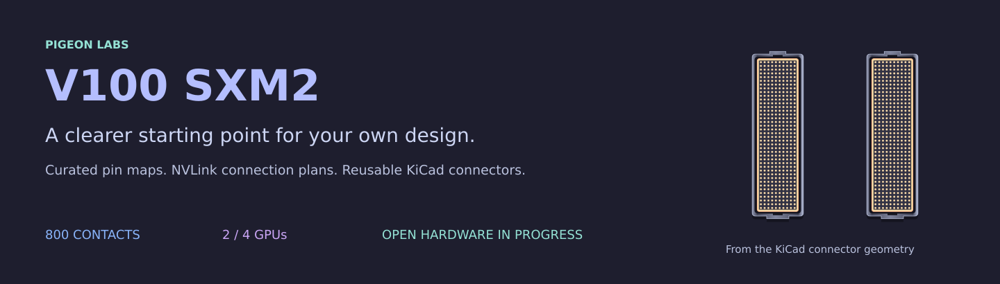
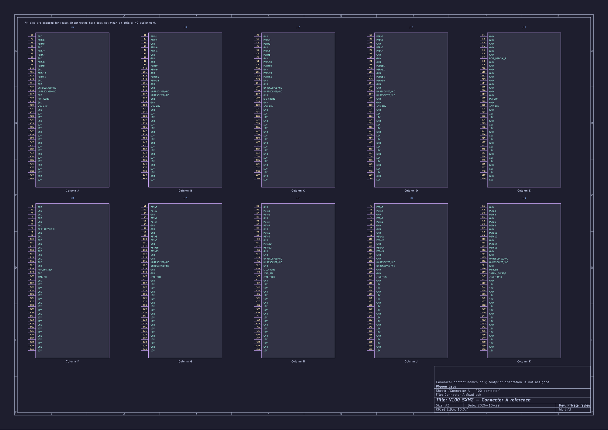
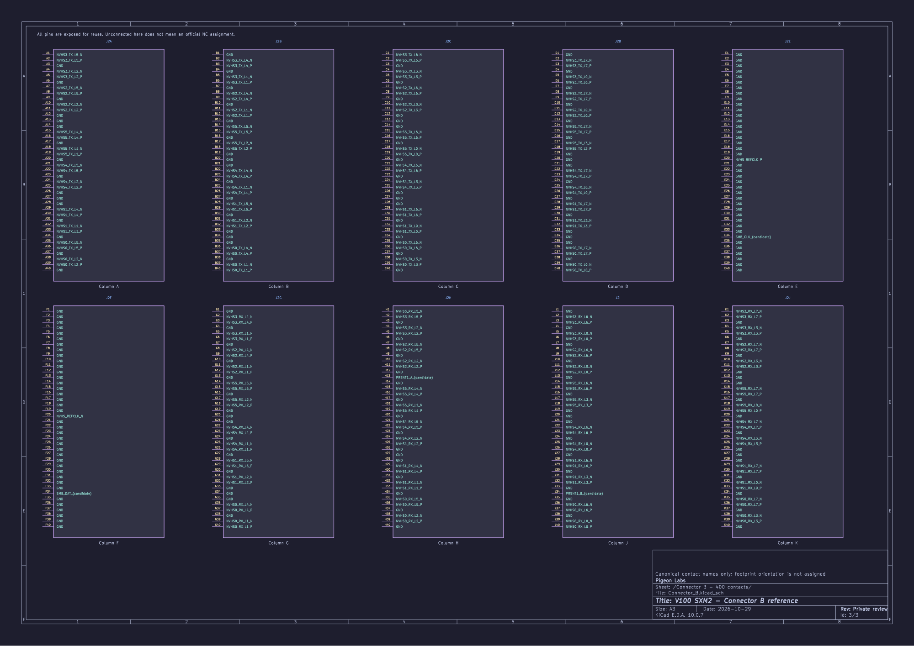
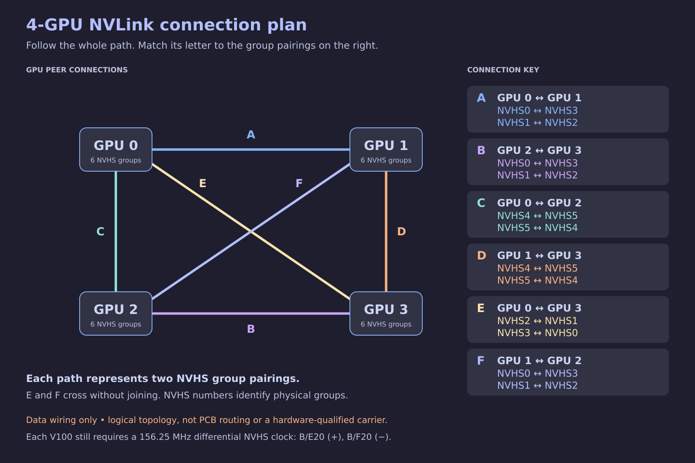
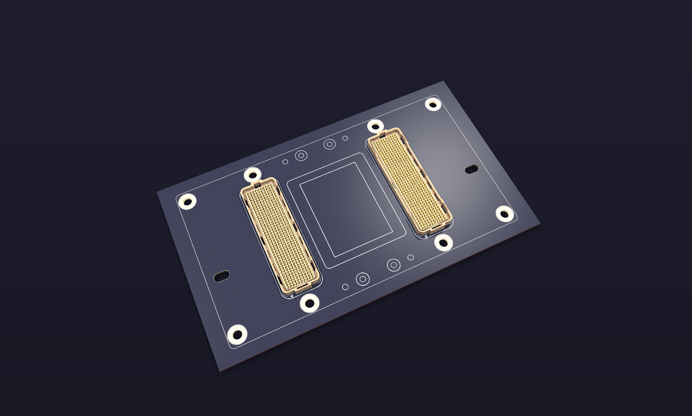

# V100 SXM2 pinout and NVLink reference

This project aims to become an **open-source carrier-board design for NVIDIA V100 SXM2 modules**, including NVLink connections for two- and four-GPU configurations.

While that board is being developed, this reference kit shares the pin mappings, connection plans and connector-only KiCad resources so other people can develop their own designs.

**My contribution so far is primarily curation:** gathering public information, comparing sources, reconciling connector orientation and signal names, and making the results easier to follow. The original reverse-engineering work belongs to its authors, credited in [Sources and attribution](docs/sources.md).

## Getting started

1. Download the complete reference ZIP from [v0.1.0-reference](https://github.com/pigeon-labs-stack/v100-sxm2-reference/releases/tag/v0.1.0-reference), or use **Code > Download ZIP** for the current development files.
2. Extract the archive and keep the directory structure. Choose a [single-, two- or four-module KiCad starter](kicad/README.md), then open its `.kicad_pro` file in **KiCad 10.0.7** or a compatible newer version. Keep the whole `kicad/` folder so the shared symbol library is available.
3. For reading without KiCad, use the [complete schematic PDFs](docs/downloads.md#read-without-kicad) or [standalone workbook](workbook/V100-SXM2-Pinout-and-NVLink.xlsx).

The [download guide](docs/downloads.md) includes print editions and library-path help. [Change notes](CHANGELOG.md) identify reference editions. This is a public reference pre-release, not a hardware-qualified carrier board.

## Start with what you need

| I want to… | Start here |
| --- | --- |
| Find a contact on connector A or B | [Pin maps and naming](docs/pinout.md) |
| Plan a connection between two V100s | [Two-GPU NVLink guide](docs/nvlink-2gpu.md) |
| Plan a four-V100 interconnect | [Four-GPU NVLink guide](docs/nvlink-4gpu.md) |
| Use the connector symbols in my own design | [KiCad starter and previews](docs/kicad.md) |
| Start with two or four V100s already connected by NVLink | [Choose a KiCad starter](kicad/README.md) |
| Work offline with the full reference | [Download the standalone workbook](workbook/V100-SXM2-Pinout-and-NVLink.xlsx) |
| Browse or print every schematic sheet without KiCad | [Complete PDF sets](docs/downloads.md#read-without-kicad) |
| Check what is established and what is open | [Status and limitations](docs/status.md) |

## What is included

- **800 canonical contacts:** 400 on connector A and 400 on connector B, with signal names, evidence and electrical-treatment notes.
- **Two- and four-GPU connection tables:** exact Connector B pads, directions, lanes and polarity.
- **Three editable KiCad starters:** one module’s A/B connectors, plus two- and four-module versions with NVLink data connected. Every contact stays labelled, including unconnected clocks, power and control pins. No regulator, power-control or clock circuits are included.
- **Catppuccin Mocha visuals:** contact maps, topology diagrams, schematic previews and the standalone dark reference workbook. An optional KiCad colour theme is included.

**External clock required:** the NVLink starter schematics show data wiring, not a complete working NVLink implementation. Each V100 needs a **156.25 MHz differential NVHS clock on B/E20 (+) and B/F20 (−)**. The separate PCIe clock is **100 MHz on A/E7 (+) and A/F7 (−)**. [Clock requirements and scope](docs/kicad.md#external-clocks-required).

## Schematics at a glance

These are the actual **connector-only KiCad schematics**: 400 labelled contacts on A and 400 on B. Click a preview to open the full-size vector drawing. The two- and four-GPU NVLink arrangements are shown separately below and in the connection guides.

### Connector A — PCIe, power contacts and control

### Connector B — NVLink and management

[Open the KiCad project](kicad/V100_Connectors.kicad_pro) · [Schematic overview](kicad/previews/Overview.svg) · [KiCad guide](docs/kicad.md)

## NVLink connection plans

The full six-group two-GPU arrangement is derived from the documented pairing families; the four-GPU arrangement follows the curated topology. Each guide explains its source evidence and remaining uncertainties. These are logical connection plans, not routed bridge schematics.

### Two GPUs

[Open the two-V100 KiCad project](kicad/2-V100/V100_2GPU_NVLink.kicad_pro) · [Native schematic previews](kicad/2-V100/README.md)

### Four GPUs

[Open the four-V100 KiCad project](kicad/4-V100/V100_4GPU_NVLink.kicad_pro) · [Native schematic previews](kicad/4-V100/README.md)

[Two-GPU connections](docs/nvlink-2gpu.md) · [Four-GPU connections](docs/nvlink-4gpu.md)

## KiCad footprint preview

The actual local reference footprint, exported directly by KiCad: 800 contact pads, housing outlines and mounting features. A raw PCB footprint is not included in this edition; see [footprint availability and open questions](docs/footprint.md) and [visual provenance](docs/visuals.md#render-provenance).

## Connector geometry preview

This is a render of an existing project geometry preview, using the Amphenol connector model. It illustrates connector placement; it is not a completed carrier board or proof of connector A/B identity, mating-part selection or viewing direction. See [render provenance](docs/visuals.md).

## Where this is going

The longer-term goal is a reusable open-source board design. This reference kit currently covers the pin mappings, NVLink connection plans and connector starter. Routed boards, manufacturing outputs and hardware qualification are future work. See the [roadmap](docs/status.md#roadmap).

Corrections are particularly useful when they include an oriented drawing, exact source reference, continuity result or measured behaviour. Please distinguish a confirmed observation from an interpretation.

Use the [correction and file-help forms](https://github.com/pigeon-labs-stack/v100-sxm2-reference/issues/new/choose), following the [contribution guide](CONTRIBUTING.md). To reference this edition in your own work, use GitHub's **Cite this repository** option or [CITATION.cff](CITATION.cff), and retain the relevant upstream source credits.

## Licence and reuse

Our original hardware design contributions use **CERN-OHL-W-2.0**; our original documentation, diagrams and workbook presentation use **CC BY-SA 4.0**. Both allow commercial reuse, with attribution/notices and the applicable reciprocal sharing requirements. See [licence scope and full texts](LICENSE.md) and [third-party notices](THIRD_PARTY_NOTICES.md). The licences do not claim ownership of pinout facts or replace upstream terms.

## Discussion and thanks

Follow the project and join the discussion on the [Level1Techs forums: designing an open-source budget 4× V100 SXM2 NVLink backplane](https://forum.level1techs.com/t/designing-an-open-source-budget-4x-v100-sxm2-nvlink-backplane-passive-pcie-vs-pex8749/250801).

Thank you to everyone on the [Level1Techs forums](https://forum.level1techs.com/) for your help, ideas and contributions to this project.
