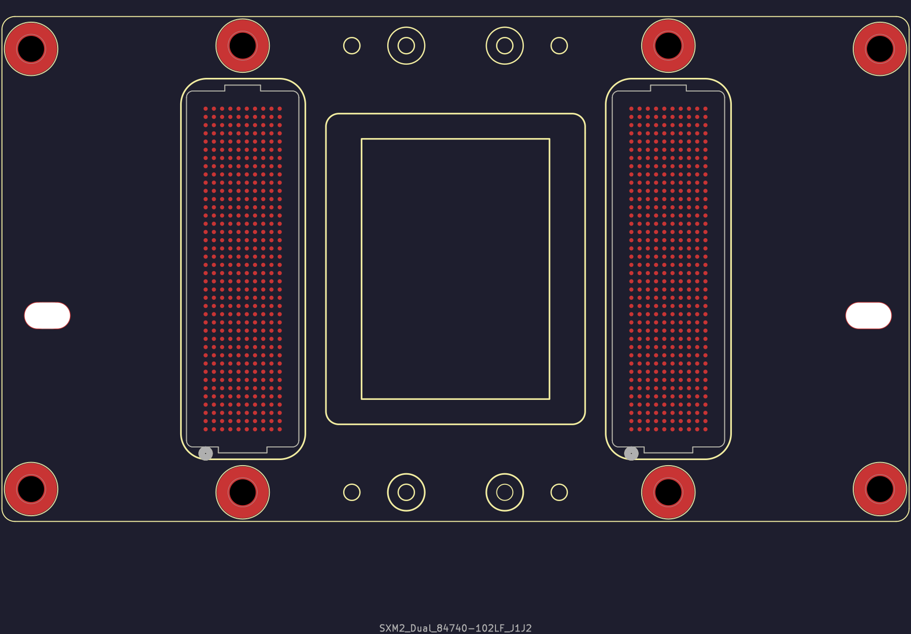

# Footprint reference and download status

[Back to the project](../README.md) · [Download guide](downloads.md)

This is the existing local dual-connector reference footprint, exported directly by KiCad. It shows two 400-contact arrays, eight round mounting holes and two slots. It is useful for discussing the physical arrangement. See [visual provenance](visuals.md#render-provenance).

**A reusable `.kicad_mod` is not included in v0.1.0-reference.** No manufacturing footprint is assigned in the schematic starters.

## What still needs establishing

| Question | Evidence needed before offering a reusable footprint |
| --- | --- |
| Source and reuse terms | Identify the origin and applicable terms of the exact local footprint and any incorporated artwork/models. A licence for our new symbols does not cover an upstream footprint automatically. |
| Physical connector identity | Establish which physical array is electrical connector A and which is B. Source J1/J2 labels alone do not establish this. |
| Viewing direction | Confirm module/carrier and mating views, mirroring, rotation and pad numbering against oriented reference material or measurements. |
| Part and mechanical fit | Confirm the intended mating part, footprint dimensions, mounting features and pad geometry for the chosen assembly. |
| Symbol-to-footprint mapping | Provide and check an explicit map between the 400-pin A/B symbols and the physical contact names; the source dual-array footprint uses prefixed J1/J2 pad names. |

## Source investigation for this edition

The local reference has been associated with the supplied SXM2 carrier geometry and [Brian Benchoff's investigation](https://bbenchoff.com/pages/SXM2PCIe.html). His article identifies hardware design files under a modified WTFPL 3.0 and points to a repository licence. At preparation of this edition, a project-wide `LICENSE` supplying those modified terms was not found in the linked [source repository](https://github.com/bbenchoff/SXM2toPCIe). A separate imported component in that repository has its own SnapMagic terms; those are not a blanket licence for the local dual-array footprint. The exact reuse terms for the local file therefore remain unresolved.

An oriented drawing, source-file provenance or measurement report would help resolve these questions. Submit it through a [reference correction issue](https://github.com/pigeon-labs-stack/v100-sxm2-reference/issues/new/choose), following the [contribution guide](../CONTRIBUTING.md).
