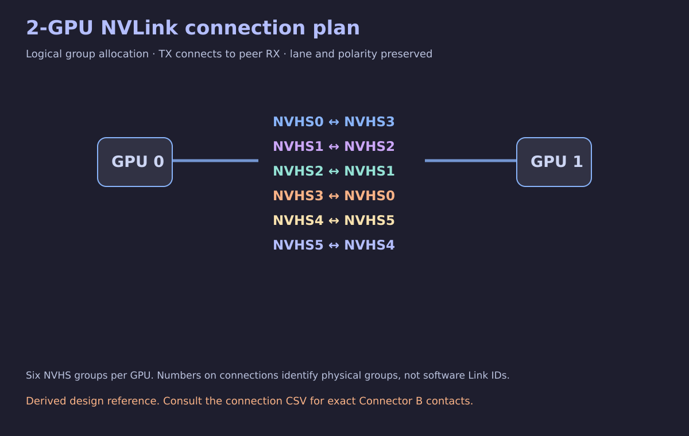

# 2-GPU NVLink connection plan

[Back to the project](../README.md)

[Open the editable two-V100 KiCad project](../kicad/2-V100/V100_2GPU_NVLink.kicad_pro) · [Schematic previews](../kicad/2-V100/README.md)

**External clock required:** data connections alone do not make working NVLink. On each V100, add a **156.25 MHz differential NVHS reference clock to B/E20 (P) and B/F20 (N)**. These clock pins remain labelled and unconnected in the starter. The separate PCIe clock input is **100 MHz on A/E7 (P) and A/F7 (N)**. See [clock requirements](kicad.md#external-clocks-required).

This full six-group arrangement is a **derived design reference**. It uses the documented 0↔3, 1↔2 and 4↔5 pairing families in both group orientations. It is not an exact copy of the partial dual-V100 reference carrier, and this repository does not report a hardware test of the complete arrangement.

## Group allocations

The groups in each row form a bidirectional link. Group pairs in the diagram use the ordering in this table. These are physical group identifiers, not NVIDIA software Link IDs.

| GPU A | Group | GPU B | Group |
| --- | --- | --- | --- |
| GPU0 | NVHS0 | GPU1 | NVHS3 |
| GPU0 | NVHS1 | GPU1 | NVHS2 |
| GPU0 | NVHS2 | GPU1 | NVHS1 |
| GPU0 | NVHS3 | GPU1 | NVHS0 |
| GPU0 | NVHS4 | GPU1 | NVHS5 |
| GPU0 | NVHS5 | GPU1 | NVHS4 |

## Exact contact connections

[Open the 192-conductor connection table](../data/nvlink-2gpu-connections.csv). Every row is one direct connection from a Connector B TX contact to the peer Connector B RX contact. Both directions are included, with lane number and P/N polarity preserved. Each module’s 192 data contacts appears exactly once across the endpoints.

The table includes GPU identity, connector, pad, complete signal name, lane and polarity. Do not merge separate differential pairs or treat the overview image as a routing drawing.

## Supporting circuits

The carrier still supplies the appropriate PCIe and NVLink reference clocks, power, reset and supporting controls. Data-lane connections do not provide the per-module NVHS reference clocks. Those circuits are outside the connector-only starter. Their design and qualification are outside this reference workbook too.

Physical A/B identity, viewing direction and mating footprint need confirmation before PCB use. The connection tables do not prescribe board stackup, trace geometry, loss/jitter budgets, cable implementation or validated bandwidth.

## Evidence

The workbook records direct agreement of 128 data contacts across NVHS0, NVHS1, NVHS4 and NVHS5 with the partial working dual carrier. NVHS2 and NVHS3 use the normalized complete mtf map. Read [Sources and attribution](sources.md) and [Status](status.md) for the limits of that evidence.
