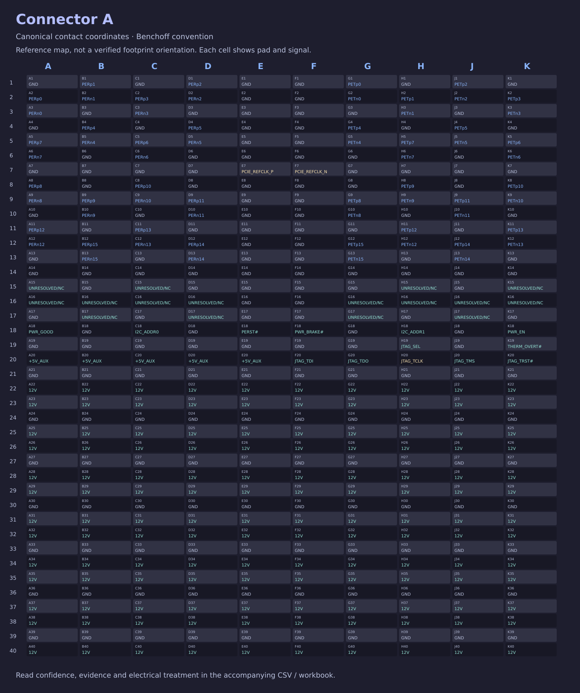
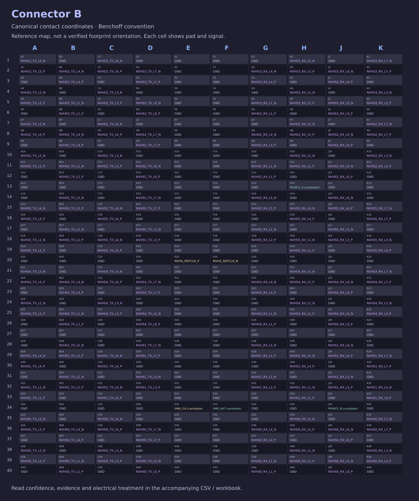

# Find a V100 SXM2 contact

[Back to the project](../README.md)

Start by choosing the **connector**, then the **pad**. The same pad coordinates occur on both connectors, so “E18” alone is incomplete.

| Connector | Main functions | Contact map | Data |
| --- | --- | --- | --- |
| A | PCIe, power, reset and control | [Open connector A map](../assets/connector-a-pinmap.svg) | [Connector A CSV](../data/connector-a.csv) |
| B | NVLink data, its reference clock and optional management contacts | [Open connector B map](../assets/connector-b-pinmap.svg) | [Connector B CSV](../data/connector-b.csv) |

The [combined CSV](../data/pinout.csv) includes all 800 contacts and their source/evidence fields. The [standalone workbook](../workbook/V100-SXM2-Pinout-and-NVLink.xlsx) covers the same pin mappings, source comparisons and two-/four-GPU connection plans as this repository, with coordinate guidance and source credits.

## Read a row

**Connector A / E18 / PERST#** identifies the connector, physical contact coordinate and assigned reset signal.

Read these fields together:

| Field | Meaning |
| --- | --- |
| `Canonical_Pad` | The contact identifier in the workbook's chosen viewing convention. |
| `Master_Signal` | The curated signal name. A candidate label remains a candidate. |
| `Class` and `Direction` | The recorded function and direction. |
| `Confidence` and `Evidence_Status` | How the assignment is supported and what the evidence does not establish. |
| `Electrical_Treatment` | The circuit treatment recorded by the workbook. |
| Raw source fields | Original labels retained for comparison; these are not substitute canonical coordinates. |

## Coordinate convention

Canonical pad names follow **Benchoff's physical viewing convention**. EasyEDA source columns are mirrored into that convention:

| Source column | A | B | C | D | E | F | G | H | J | K |
| --- | --- | --- | --- | --- | --- | --- | --- | --- | --- | --- |
| Canonical column | K | J | H | G | F | E | D | C | B | A |

Row numbers do not change. There is no column I.

Before transferring these coordinates into a footprint, establish which physical view you are using and which connector is A or B. The existing geometry preview does not establish those electrical identities. `Orientation_Crosswalk` in the workbook explains the translation and signal naming conventions.

## NVLink signal names

`NVHS0_RX_L0_P` means physical group 0, receive lane 0, positive contact. `TX` means transmit and `N` identifies the negative contact. RX/TX are described from the module's perspective.

NVHS0–NVHS5 are physical group names. Their numbering is not assumed to match NVIDIA software Link IDs.

A source marked **NC** may simply leave that contact unused. It does not establish an official NVIDIA no-connect assignment.

