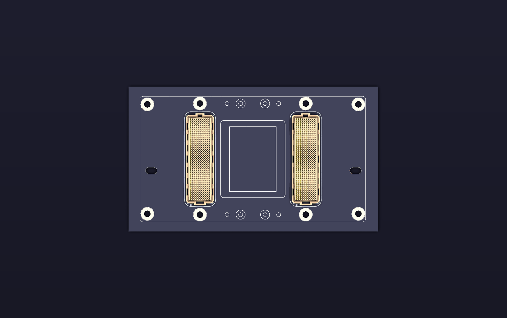

# Visuals and theme

[Back to the project](../README.md)

The reference kit uses **Catppuccin Mocha**: dark navy backgrounds, bright readable text and pastel accents. Labels and tables carry the meaning as well as colour.

GitHub's surrounding page follows each visitor's theme. The SVG diagrams and schematic previews include their own dark backgrounds. The standalone workbook is already styled. CSV files remain plain data; GitHub controls their table appearance.

## Render provenance

`assets/footprint-reference.png` is a native KiCad export of the existing local `SXM2_Dual_84740-102LF_J1J2_centered.kicad_mod` reference footprint, with its original pads and outlines. KiCad plots the front copper, front silkscreen, front fabrication and edge-cut layers; the PNG uses a Catppuccin Mocha background. The footprint shares the supplied SXM2 carrier reference provenance described below. This image does not add a downloadable PCB footprint to the repository or confirm electrical A/B identity, viewing direction or manufacturing suitability.

`assets/connector-render.png` is a native KiCad 3D render of the existing local `SXM2_3D_preview.kicad_pcb` project geometry. Its embedded connector model comes from the [Amphenol s84740 model archive](https://cdn.amphenol-cs.com/media/wysiwyg/files/3d/s84740.zip). The local project traces the dual-array geometry back to the supplied SXM2 carrier reference footprint; [Benchoff's source project](https://bbenchoff.com/pages/SXM2PCIe.html) is credited for that reference context. The image is a geometry illustration, not a completed board design. It does not verify the A/B electrical identity, physical view or mating connector.

The cover uses two vector connector drawings extracted from the local KiCad geometry: the single-connector footprint supplies all 400 pad positions and diameters, and the reference footprint’s fabrication layer supplies the keyed housing outline. Metallic shading and the inner surround are simplified for readability. The drawings share the reference geometry provenance above; their placement on the banner does not assign electrical A/B identity or establish a manufacturing footprint.

The topology diagrams are newly drawn SVGs. The full contact-map SVGs represent all 400 canonical contact coordinates per connector.

The topology diagrams show allocations, not trace routing, cable geometry or demonstrated bandwidth. All exact lane/polarity information is in the accompanying CSV files.

The second render uses the same geometry and provenance as the angled view. Neither assigns physical connector A/B identity.

Original visual presentation is licensed as described in [LICENSE.md](../LICENSE.md). Source-derived connector geometry, the native footprint image and the two manufacturer-model renders are excluded from the blanket CC licence; see [third-party notices](../THIRD_PARTY_NOTICES.md).

The optional KiCad theme is in [`kicad/themes/v100-mocha.json`](../kicad/themes/v100-mocha.json). The main colours are:

| Use | Catppuccin Mocha colour |
| --- | --- |
| Background | Base `#1E1E2E` |
| Panels | Surface 0 `#313244` |
| Text | Text `#CDD6F4` |
| PCIe and contact identifiers | Blue `#89B4FA` |
| NVLink | Mauve `#CBA6F7` |
| Supporting functions | Teal `#94E2D5` |
