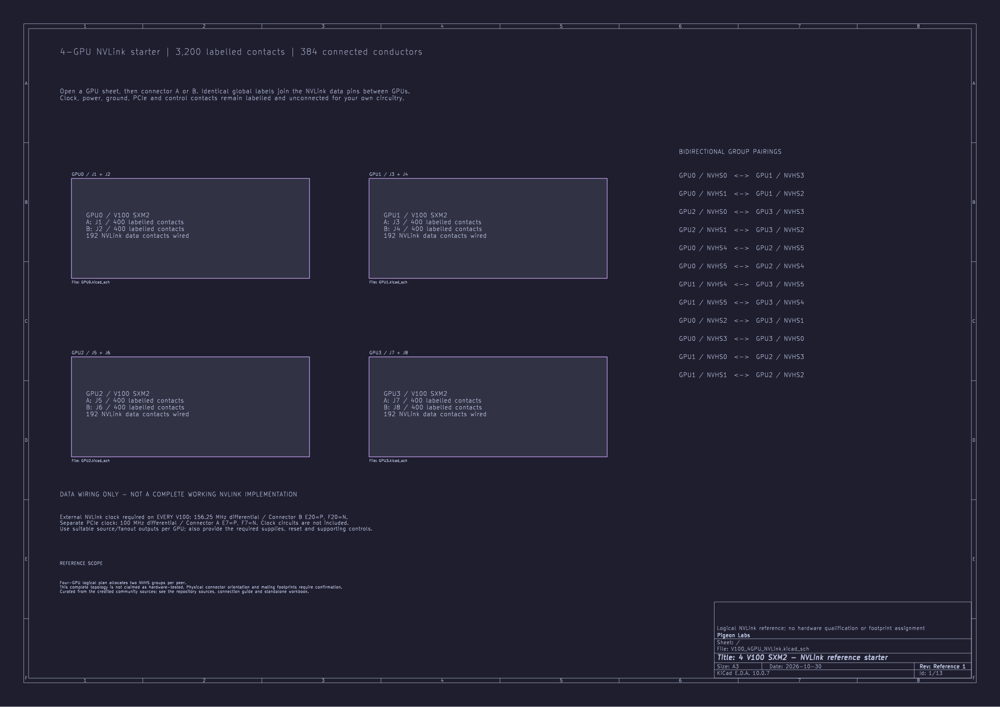

# 4-V100 NVLink starter

[Back to the KiCad starters](../README.md)

Open [V100_4GPU_NVLink.kicad_pro](V100_4GPU_NVLink.kicad_pro) in KiCad 10.0.7 or a compatible newer version. Keep the parent `kicad/` directory with its shared symbol library when copying this project.

The root links to GPU0–GPU3. Each GPU has separate A and B connector sheets. Every module includes all **800 labelled contacts**. Exactly **384 NVLink data conductors** connect the modules through matching global labels; the [connection table](../../data/nvlink-4gpu-connections.csv) lists every endpoint.

**Clock pins remain labelled and unconnected**, together with ground, power, PCIe and control contacts. Add your own supporting circuits. No pins are marked NC merely because this reference leaves them unused, and no footprints are assigned.

## External clocks are required

**This is data wiring, not a complete working NVLink implementation.** Every V100 needs a **156.25 MHz differential NVHS reference clock** on connector **B/E20 = NVHS_REFCLK_P** and **B/F20 = NVHS_REFCLK_N**. The separate PCIe reference input is **100 MHz differential**, on **A/E7 = PCIE_REFCLK_P** and **A/F7 = PCIE_REFCLK_N**.

The pins and rates use the [canonical pin-map convention](../../data/pinout.csv). Provide suitable clock source/fanout circuitry and an output pair per module; clock outputs must not be tied together. The [clock requirements](../../docs/kicad.md#external-clocks-required) explain the scope and source evidence. Clock generators, termination and distribution circuits are not included.

`G0_TX0_L0_P` means **GPU0 / NVHS0 transmit / lane 0 / positive**. Net labels use the transmitting contact’s name at both ends of the connection. The full source and destination signal names remain beside the pins and in the connection table. The reverse direction has its own net.

| Label part | Meaning |
| --- | --- |
| `G0` | Transmitting GPU0. |
| `TX0` | Physical NVHS0 transmit group. |
| `L0` | Lane 0 within that group. |
| `P` / `N` | Positive / negative contact of the differential pair. |

Global labels apply throughout a KiCad project. Add a prefix or rename them when combining these starters or placing multiple copies in one design.

The [NVLink guide](../../docs/nvlink-4gpu.md) explains the topology and its evidence limits. This is an editable logical reference, not a hardware-qualified carrier board.

Original hardware design contributions use [CERN-OHL-W-2.0](../../LICENSES/CERN-OHL-W-2.0.txt). Keep the [licence scope](../../LICENSE.md), applicable licence text and [third-party notices](../../THIRD_PARTY_NOTICES.md) with copies of these files. Commercial reuse is allowed under those terms.

## Preview

[GPU0 connector B: all NVLink net labels](previews/GPU0_Connector_B.svg)
