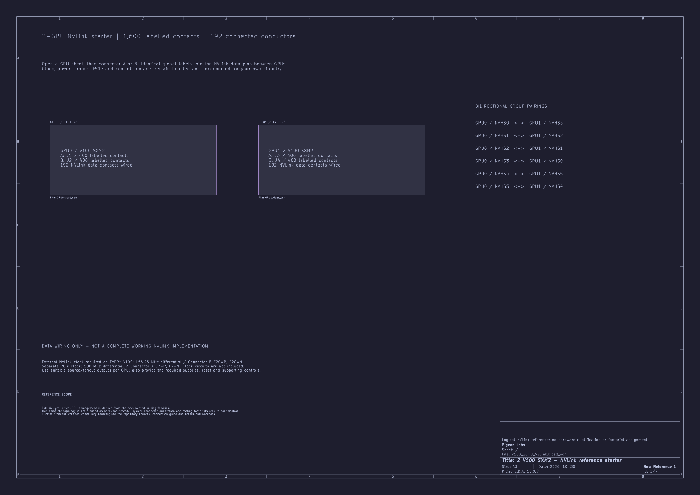

# Choose a KiCad starter

[Back to the project](../README.md) · [Pin naming and orientation](../docs/pinout.md)

New here? Follow the [download and opening guide](../docs/downloads.md). [Complete PDF sets](../docs/downloads.md#read-without-kicad) are available in Catppuccin Mocha and white-background print editions.

| I need… | Open this project | Included |
| --- | --- | --- |
| One module’s reusable connector symbols | [V100_Connectors.kicad_pro](V100_Connectors.kicad_pro) | One A/B pair; all 800 contacts labelled and unconnected. |
| Two modules with NVLink connected | [2-V100/V100_2GPU_NVLink.kicad_pro](2-V100/V100_2GPU_NVLink.kicad_pro) | Four connectors; 1,600 contacts; 192 NVLink data conductors. |
| Four modules with NVLink connected | [4-V100/V100_4GPU_NVLink.kicad_pro](4-V100/V100_4GPU_NVLink.kicad_pro) | Eight connectors; 3,200 contacts; 384 NVLink data conductors. |

**Clock pins remain labelled and unconnected in every starter.** Power, ground, PCIe, reset and management/control contacts also retain their names and pad numbers, ready for your own circuits. Only NVLink data lanes are wired in the two- and four-module projects.

## External clocks are required

**These schematics are not a complete working NVLink implementation.** Supply the following reference clocks to **each V100 module**:

| Clock input | Frequency | Positive contact | Negative contact |
| --- | --- | --- | --- |
| NVLink / NVHS | **156.25 MHz differential** | **B/E20 — NVHS_REFCLK_P** | **B/F20 — NVHS_REFCLK_N** |
| PCIe, separate from NVLink | **100 MHz differential** | **A/E7 — PCIE_REFCLK_P** | **A/F7 — PCIE_REFCLK_N** |

Use the canonical pad convention and suitable clock source/fanout circuitry, with an output pair per module. Generators, buffering, termination and clock distribution are not included. See [clock requirements and source evidence](../docs/kicad.md#external-clocks-required).

Open the `.kicad_pro` file in KiCad 10.0.7 or a compatible newer version. Keep this directory together when copying a starter: all three projects use the shared `V100_Reference.kicad_sym` library. Each multi-GPU project opens at an overview, then a GPU sheet, then its A/B connector sheets.

These are editable logical reference schematics. No PCB footprints are assigned. The [KiCad guide](../docs/kicad.md) explains reuse, global net names, the optional dark theme and the checks still needed for a physical design.

Original hardware design contributions are licensed under [CERN-OHL-W-2.0](../LICENSES/CERN-OHL-W-2.0.txt). Keep the [licence scope](../LICENSE.md), applicable licence text and [third-party notices](../THIRD_PARTY_NOTICES.md) with copies of the starter files. Commercial reuse is allowed under those terms.

## Two V100s

[Two-GPU project notes and NVLink pin preview](2-V100/README.md)

## Four V100s

[Four-GPU project notes and NVLink pin preview](4-V100/README.md)
